

  <a href="https://alim.wtf"></a>

<a href="https://alim.wtf">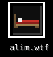</a><a href="https://agentmash.dev">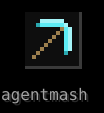</a><a href="https://x.com/alimwtf">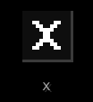</a><a href="https://t.me/alimwtf">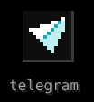</a>

i’m alim, 18, from astana. co-founder &amp; ceo @ <a href="https://agentmash.dev">agentmash</a>. 
full-time on agentmash, part-time working 2 swe jobs and running an auditing studio. 
the youngest swe astana hub has ever had. still a delusional self-believer.

### now.

<a href="https://agentmash.dev"></a>

every agent is told which files a teammate’s agent is changing, before it edits them. 
closed beta, <a href="https://agentmash.dev">request early access ↗</a>

### advancements.


### inventory.


### quests.

<a href="https://github.com/dauletbekalim/motion-ui-videos">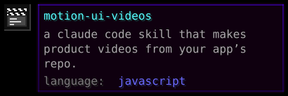</a><a href="https://github.com/dauletbekalim/A.C.T.I.V.E.-Rover-code">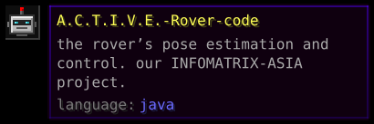</a><a href="https://github.com/dauletbekalim/narkesken">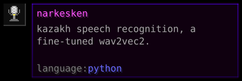</a><a href="https://github.com/dauletbekalim/dauletbekalim">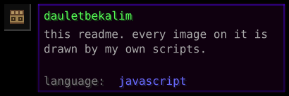</a>

### commits, live.

### press.

<a href="https://digitalbusiness.kz/2026-10-23/paren-iz-astani-v-18-let-zarabativaet-millioni-tenge-v-mesyats-na-it/">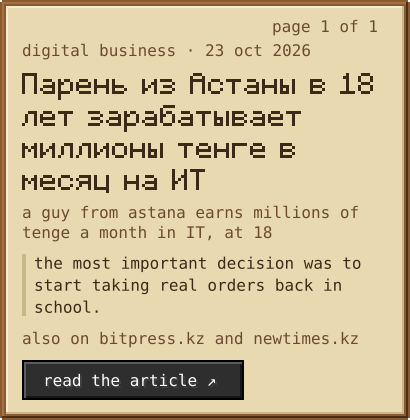</a>

say hi on <a href="https://t.me/alimwtf">telegram</a> · drawn by me, with a few agents watching each other.

